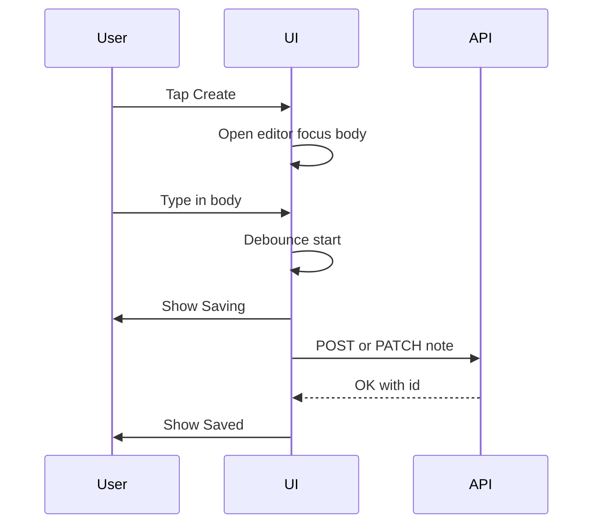
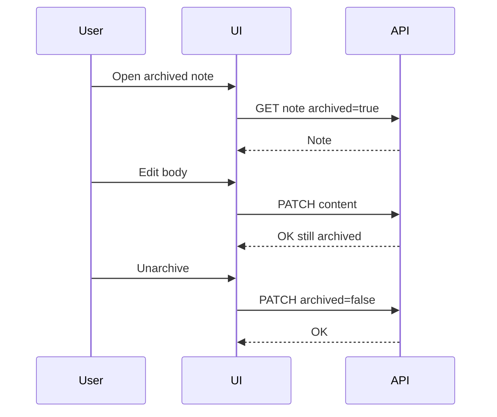
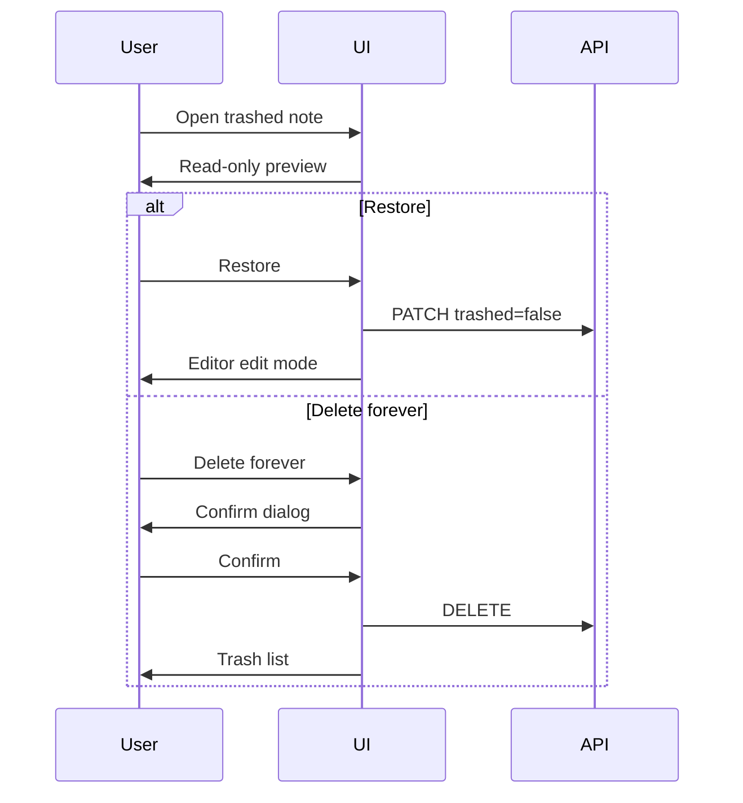

# Notes App — Interaction Specifications

This document describes user flows, feedback, transitions, and behavioral rules. It complements [`screen-specifications.md`](screen-specifications.md) and [`design-tokens.md`](design-tokens.md).

**Breakpoint rule for confirms:** Mobile (`< md`) uses **bottom sheets**; desktop (`≥ md`) uses **centered dialogs**. Same copy and button order: primary safe action on the right (desktop) or bottom (sheet stack).

---

## Navigation

### Bottom navigation (mobile)

| Item     | Action                                                                                                                     |
| -------- | -------------------------------------------------------------------------------------------------------------------------- |
| Home     | Route to Home; clears transient search if policy is reset-on-tab (recommended: preserve last search only within Notes tab) |
| Create   | New note editor (new id on server after first save)                                                                        |
| Notes    | Notes list                                                                                                                 |
| Settings | Settings                                                                                                                   |

Active tab: `accent-brand` styling. Tapping active tab scrolls to top (optional).

### Sidebar (desktop)

Same destinations plus **Library**: Tags, Archive, Trash. Create may be a full-width button at top of sidebar.

### Contextual entry

| From                  | To                        |
| --------------------- | ------------------------- |
| Home footer links     | Tags, Archive, Trash      |
| Home tag chip         | Notes + tag filter        |
| Home search tap       | Notes with search focused |
| Settings Library rows | Tags, Archive, Trash      |
| Note overflow         | Archive, Trash            |

### Deep linking

Routes (production): `/`, `/notes`, `/notes/[id]`, `/tags`, `/archive`, `/trash`, `/settings`. Editor deep link opens note in edit mode unless trashed (redirect to trash preview).

### Back stack

- Editor → previous list or Home (history back)
- Trash preview → Trash list
- Tag filter on Notes → clearing chip stays on Notes

---

## Create note

1. User taps **Create** (bottom nav or empty-state CTA).
2. App navigates to editor with empty title and body.
3. Focus moves to **body** after mount (short delay acceptable for a11y, avoid scroll jump).
4. On first meaningful input (non-whitespace), autosave creates persisted note.
5. Header shows Saving → Saved.

---

## Editor: autosave and back

### Autosave

- Debounce **600ms** after last keystroke (recommended).
- Coalesce title and body changes into one request when possible.
- **Saving**: show immediately when request starts.
- **Saved**: show on success; reduce emphasis after 2s.
- **Error**: persist message + **Retry** until success; Retry re-sends last payload.

### Unsaved / back navigation

Show confirmation when **any** of:

- A save request is **in flight**, or
- The last save **failed** (dirty relative to server)

Copy: “Leave without saving?” with **Stay** (primary) and **Leave** (destructive/secondary).

If saved and idle, back navigates without prompt.

### Formatting toolbar

- Toggles apply to selection or current block.
- **Link**: sheet with URL field + Save; invalid URL inline error.
- **More** (mobile): sheet with additional formats; dismiss on select or swipe down.

### Overflow actions

| Action    | Behavior                                          |
| --------- | ------------------------------------------------- |
| Pin       | Toggle; list order unchanged on Notes             |
| Tags      | Sheet with multi-select / create tag              |
| Archive   | Set archived flag; navigate back to previous list |
| Trash     | Confirm → set trashed; navigate to Notes or Trash |
| Unarchive | Clear archived; stay in editor                    |

---

## Search

1. User focuses search on Home or Notes.
2. Input debounces **300ms** before query.
3. Results replace list (Notes) or navigate to Notes with query (from Home tap).
4. Clear control resets query and shows default list.
5. **No highlighting** required in MVP; optional subtle bold in title only in a later iteration.

**Scope:** title, body plain text, tags. Case-insensitive recommended.

### No results

Empty list state with query preserved; **Clear search** button.

---

## Lists: scroll and refresh

| Gesture         | Context                        | Behavior                                       |
| --------------- | ------------------------------ | ---------------------------------------------- |
| Pull-to-refresh | Notes, Archive, Trash (mobile) | Reload first page                              |
| Infinite scroll | Notes, Archive, Trash          | Fetch next page near bottom threshold (~400px) |
| Tap card        | Lists                          | Open editor or trash preview                   |

Optional swipe actions (secondary to overflow menu): Archive, Trash. If implemented, use short swipe reveal with haptic on supported devices.

---

## Pin

- Toggle from editor overflow or note list overflow (not a separate Notes sort).
- Pinned notes appear in **Home → Pinned** (max **5** shown; if more, “See all pinned” links to Notes with visual pin filter optional—MVP: show 5 most recently updated pins).
- Pin icon on card when `pinned === true`.

---

## Tags

- **Add/remove** in editor via Tags sheet; autocomplete existing tags.
- **Create** on Tags screen via header +.
- **Rename/delete** on Tags screen row menu; delete confirms with note count.
- **Filter**: tap tag → Notes with chip; chip X clears filter.

Filter persists until cleared or user navigates Home (recommended: persist until cleared).

---

## Archive

- Archive from editor or list overflow.
- Archived notes only on **Archive** screen (not main Notes).
- Open archived note → full editor; edits save **while remaining archived**.
- **Unarchive** only via explicit menu action.

---

## Trash

- **Move to Trash** from editor/list with confirm.
- Trashed notes appear only under **Trash**.
- Tap → **read-only preview** (no toolbar, no focus in body).
- **Restore** → active note, navigate to editor edit mode.
- **Delete forever** → confirm → permanent delete → return to Trash list.

### Permanent delete confirmation

Title: “Delete this note permanently?”  
Body: “This can’t be undone.”  
Actions: **Cancel** | **Delete** (destructive).

---

## Theme

| Option | Behavior                                         |
| ------ | ------------------------------------------------ |
| Light  | `html` without `dark` class                      |
| Dark   | `html` with `dark` class                         |
| System | Match `prefers-color-scheme`; listen for changes |

Apply theme synchronously on load (inline script or blocking class) to avoid flash. Store preference in local storage / user profile.

---

## Keyboard (desktop)

Nice-to-have for MVP implementation:

| Shortcut         | Action                          |
| ---------------- | ------------------------------- |
| `Cmd/Ctrl + N`   | New note                        |
| `Cmd/Ctrl + K`   | Focus search                    |
| `Escape`         | Close sheet/dialog              |
| `Cmd/Ctrl + B/I` | Bold/italic when editor focused |

Focus trap in dialogs and sheets; return focus to trigger on close.

---

## Motion and transitions

| Transition         | Duration          | Easing          | Reduced motion         |
| ------------------ | ----------------- | --------------- | ---------------------- |
| Route change       | `duration-normal` | `ease-standard` | Opacity crossfade only |
| Bottom sheet open  | `duration-slow`   | `ease-standard` | Instant open + opacity |
| Bottom sheet close | `duration-normal` | `ease-standard` | Instant                |
| Dialog             | `duration-normal` | `ease-standard` | Opacity                |
| Save status fade   | `duration-normal` | `ease-standard` | No fade                |

Sheets: drag handle on mobile; swipe down to dismiss unless destructive confirm requires explicit button.

---

## Errors and feedback

| Context            | Pattern                                                                        |
| ------------------ | ------------------------------------------------------------------------------ |
| List load failure  | Inline banner + Retry in screen body                                           |
| Save failure       | Editor header persistent error + Retry                                         |
| Tag delete failure | Toast or inline on Tags row                                                    |
| Logout failure     | Toast                                                                          |
| Network offline    | Optional banner “You’re offline” (implementation); save errors still use Retry |

Toasts: `z-toast`, auto-dismiss 4s except errors (manual dismiss).

---

## Accessibility interactions

- Save status: `aria-live="polite"` region in editor header.
- Confirm dialogs: focus first button (Stay); label dialog with `aria-labelledby`.
- Bottom sheets: `role="dialog"` + `aria-modal="true"`.
- Trash preview: announce “Read-only” for screen readers.
- Reduced motion: honor OS setting for all animated transitions.

---

## Product rules checklist (interactions)

| Rule                                   | Spec location                 |
| -------------------------------------- | ----------------------------- |
| Single entity: Note                    | No type switchers in any flow |
| Sort `updatedAt` desc, `_id` tie-break | Lists, infinite scroll        |
| Search title, body, tags               | Search section                |
| Pin = Home grouping only               | Pin section                   |
| Archive edit without unarchive         | Archive sequence              |
| Trash read-only until restore          | Trash section                 |
| No MVP attachments/collab/AI           | design-brief boundaries       |

---

## Related documents

- [`design-brief.md`](design-brief.md)
- [`design-tokens.md`](design-tokens.md)
- [`screen-specifications.md`](screen-specifications.md)
