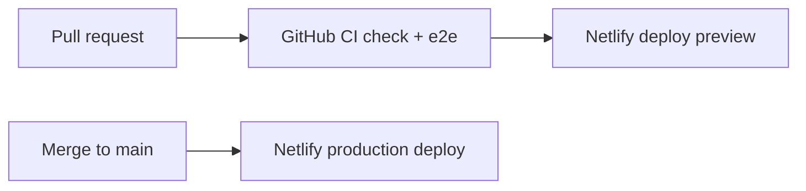

# Deploy and rollback

SKNotes ships as a **Next.js** application on **Netlify** using the official Next.js plugin. Infrastructure-as-code for the host is minimal: [`netlify.toml`](../../netlify.toml) defines the build command and plugin.

## Pipeline overview

| Stage              | Trigger                                        | Result                                                                                                                           |
| ------------------ | ---------------------------------------------- | -------------------------------------------------------------------------------------------------------------------------------- |
| **CI**             | Push or PR to `main`                           | `npm run ci` (lint, format, unit tests, build) and Playwright E2E — [`.github/workflows/ci.yml`](../../.github/workflows/ci.yml) |
| **Deploy preview** | Pull request (Netlify Git integration)         | Isolated URL per PR; set preview env vars — [environment.md](./environment.md)                                                   |
| **Production**     | Merge to `main` (protected branch recommended) | Production context env vars; live site                                                                                           |

Connect the GitHub repository in Netlify, set **production branch** to `main`, and enable **Deploy Previews** for pull requests.

## Build configuration

From `netlify.toml`:

- **Build command:** `npm run build`
- **Plugin:** `@netlify/plugin-nextjs` (handles Next.js routing and serverless functions)

Environment variables are **not** in the repo. Configure MongoDB, Better Auth, Resend, and OAuth credentials in the Netlify UI for each context.

## Pre-deploy checks (operator)

1. CI green on the merging commit (`check` and `e2e` jobs).
2. Smoke the Netlify **deploy preview** URL: sign-in, create/edit note, sign-out.
3. Confirm production env vars match the canonical domain (`BETTER_AUTH_URL`, `NEXT_PUBLIC_BETTER_AUTH_URL`, `EMAIL_FROM` on verified domain).
4. After schema or index changes, run `npm run ensure-indexes` against the target cluster (documented in [backups.md](./backups.md)).

## Rollback

Application rollback is **redeploy a known-good Netlify deploy** — no separate artifact registry.

1. Open Netlify → **Deploys**.
2. Find the last successful production deploy before the incident.
3. Use **Publish deploy** (or “Restore”) on that deploy.
4. If the incident involved **bad data** or **env var** changes, rolling back the site alone is insufficient — follow [backups.md](./backups.md) and fix `MONGODB_URI` or secrets as needed.

Rollback does not revert MongoDB writes made during a bad release; pair deploy rollback with backup restore when data is affected.

## Custom domains

1. Add the domain in Netlify and complete DNS (apex + `www` if used).
2. Update `BETTER_AUTH_URL` and `NEXT_PUBLIC_BETTER_AUTH_URL` to the canonical HTTPS origin.
3. Update Google OAuth authorized origins/redirect URIs and Resend link domains if applicable.

## Related

- [Environment](./environment.md)
- [Monitoring](./monitoring.md)
- [Resend email setup](../integrations/resend-email.md)
